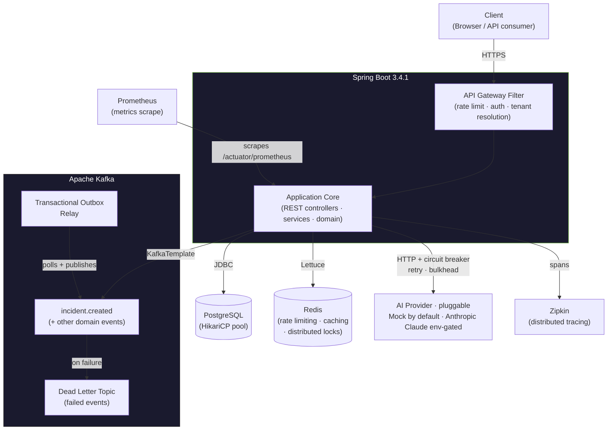

<!-- Badges -->
<p align="center">
  
  
  
  
  
  
  
  
  
</p>

<h1 align="center">AetherOps</h1>

<p align="center">
  AetherOps turns backend failures into evidence-backed AI investigations — with confidence scores, explicit unknowns, and safe runbooks. Built for Spring Boot teams.
</p>

<!-- TODO: add a screenshot of the live landing page here, e.g.
 -->

---

## Live Demo

**[https://aetheropsai.com/landing.html](https://aetheropsai.com/landing.html)**

> Demo tenant available — click **Try Demo** on the landing page. No account required.


---

## Architecture



AI analysis defaults to a deterministic mock provider for demo reliability and zero inference cost. Real Anthropic integration is implemented behind a Strangler Fig feature flag — set `ANTHROPIC_API_KEY` to enable it.

---

## Tech Stack

| Technology | Purpose |
|---|---|
| Java 17 + Spring Boot 3.4.1 | Core framework, dependency injection, auto-configuration |
| PostgreSQL + Flyway | Relational persistence with versioned schema migrations |
| Redis (Lettuce / Redisson) | Distributed rate limiting, response caching, distributed locks |
| Apache Kafka | Asynchronous event streaming, Dead Letter Queue, Transactional Outbox |
| Resilience4j | Circuit breaker, retry with exponential backoff, bulkhead isolation |
| Micrometer + Prometheus | Metrics collection, `/actuator/prometheus` scrape endpoint |
| Micrometer Tracing + Zipkin | End-to-end distributed tracing across service boundaries |
| Spring Security + JWT | Stateless authentication, role-based authorization |
| Testcontainers | Integration tests against real PostgreSQL and Redis instances |
| Docker + Kubernetes | Multi-stage image build, namespace-scoped K8s manifests, HPA |
| GitHub Actions | CI pipeline (test + build + push to GHCR) with PR quality checks |

---

## Key Features

### Security
- Stateless JWT authentication with sliding refresh tokens
- Two-factor authentication via TOTP (Google Authenticator compatible)
- Google OAuth 2.0 social login
- Per-IP rate limiting enforced at the servlet filter layer
- BCrypt password hashing with configurable strength

### Resilience
- Resilience4j circuit breaker around the Anthropic AI client — degrades gracefully to a static fallback response when the upstream is unavailable
- Retry with exponential backoff and jitter on transient AI API failures
- Bulkhead to cap concurrent AI requests and prevent thread-pool saturation

### Event-Driven
- Kafka event publishing on incident lifecycle transitions (`incident.created`, etc.)
- Dead Letter Queue for events that exhaust retries — no silent drops
- Transactional Outbox pattern ensures at-least-once delivery without dual-write inconsistency

### Architecture Patterns
- Event Sourcing and CQRS for incident state reconstruction and read-model separation
- Distributed Saga with compensating transactions for multi-step workflows
- Domain-Driven Design — bounded contexts, aggregates, domain events
- API Gateway filter for cross-cutting concerns (auth, tenant resolution, rate limiting)
- Strangler Fig approach for incremental replacement of legacy incident handling

### Observability
- Micrometer metrics on every key operation, scraped by Prometheus
- Zipkin distributed tracing with per-request trace and span propagation
- Spring Boot Actuator health groups: liveness, readiness, and per-dependency checks (DB, Redis, Kafka)

### Data
- Multi-tenancy enforced at the repository layer — every query is scoped by `tenantId`
- Soft delete with `deletedAt` timestamps — no hard data loss on entity removal
- Idempotency keys on mutation endpoints — safe to retry without duplicate side-effects
- Redisson distributed locks for cluster-safe critical sections

### Multi-Tenant Security
- PostgreSQL Row-Level Security — tenant isolation enforced at the database level, not just application code
- API key authentication (SHA-256 hashed) as a separate auth path alongside JWT
- Webhook payloads signed with HMAC-SHA256 (same pattern as Stripe)

### Rate Limiting & Abuse Protection
- Sliding window rate limiting via Redis sorted sets (fixes the fixed-window boundary vulnerability)
- DDoS protections: request size limiting, security headers, rate-limit response headers

### Operational Intelligence
- Incident correlation engine — groups related incidents within a 5-minute window instead of duplicating
- Scheduled weekly MTTR and incident reports per tenant (cron-based)
- Audit log export (CSV/JSON, streaming response)
- Per-tenant and global feature flags via Redis
- Usage billing hooks with period aggregation

### AI & Similarity Retrieval
- Email verification on registration with Resend API delivery (24-hour expiry tokens, re-send endpoint)
- Embedding-based similar-incident retrieval (RAG-lite) — resolved incidents indexed as keyword-weighted float vectors; top-3 similar incidents with resolution notes injected into every AI analysis prompt

---

## Getting Started

### Prerequisites

- Java 17 ([Temurin](https://adoptium.net/))
- Docker (for Testcontainers and local infrastructure)
- Maven 3.9+

### Run Locally

```bash
# 1. Clone the repository
git clone https://github.com/akhilleusn/aetherops.git
cd aetherops

# 2. Configure environment variables
cp .env.example .env
# Open .env and fill in DB credentials, JWT secret, and optional API keys
# ANTHROPIC_API_KEY is optional — the app runs on a deterministic mock AI provider if unset.

# 3. Start infrastructure (PostgreSQL, Redis, Kafka, Zipkin)
docker-compose up -d

# 4. Run the application
mvn spring-boot:run
```

The API will be available at `http://localhost:8080`.  
Zipkin UI: `http://localhost:9411`

---

## Running Tests

```bash
mvn clean test
```

> **339 integration tests** run against real PostgreSQL and Redis instances via Testcontainers. Docker must be running — Testcontainers pulls and starts containers automatically.

Test coverage includes: authentication flows, JWT lifecycle, TOTP enrollment, Google OAuth, multi-tenant isolation, incident grouping, AI analysis (circuit breaker + fallback), audit logging, rate limiting, Kafka event publishing, Transactional Outbox, Evidence Packs, Postmortems, Runbooks, and more.

---

## Kubernetes Deployment

The `kubernetes/` directory contains production-ready manifests. Apply them in order:

```bash
# 1. Create the namespace
kubectl apply -f kubernetes/namespace.yaml

# 2. Fill in real base64-encoded values in the secret template
#    Encode each value with: echo -n "your-value" | base64
vi kubernetes/secret.yaml

# 3. Apply all manifests (namespace, configmap, secret, deployment, service, ingress, hpa, pdb)
kubectl apply -f kubernetes/

# 4. Verify pods are healthy
kubectl get pods -n aetherops
kubectl get hpa   -n aetherops
```

The HPA scales between 2 and 10 replicas based on CPU (70%) and memory (80%) utilisation. The PodDisruptionBudget guarantees at least one pod remains available during node maintenance or rolling updates.

---

## API Documentation

| Endpoint | Description |
|---|---|
| `http://localhost:8080/swagger-ui.html` | Interactive Swagger UI — browse and execute every API endpoint |
| `http://localhost:8080/actuator/health` | Liveness, readiness, and per-dependency health checks (DB, Redis, Kafka) |
| `http://localhost:8080/actuator/prometheus` | Prometheus metrics scrape endpoint |

Swagger UI is available in all profiles. The OpenAPI spec is generated at startup from `@Operation` and `@Schema` annotations on the controller layer.

---

## Project Structure

```
src/main/java/com/aetherops/
│
├── analysis/          # AI analysis — circuit breaker + retry + bulkhead around AI provider
├── apikey/            # API key management — SHA-256 hashed, per-tenant
├── audit/             # Immutable audit trail for every tenant action
├── auth/              # JWT, TOTP 2FA, Google OAuth, email verification, password reset
├── common/            # Shared exceptions, response wrappers, converters
├── config/            # SecurityConfig, WebConfig, feature flags, rate limit config
├── demo/              # DemoDataInitializer — seeds demo tenant, incidents, embeddings
├── evidence/          # Evidence pack assembly from log events
├── incident/          # Core incident lifecycle — CRUD, grouping, correlation, severity
├── ingestion/         # Log event ingestion endpoint — secret masking, deduplication
├── masking/           # Secret masking service (JWT, API keys, passwords redacted pre-storage)
├── outbox/            # Transactional Outbox — at-least-once Kafka delivery
├── postmortem/        # AI-generated postmortem drafts
├── project/           # Project management — multi-project support per tenant
├── ratelimit/         # Sliding-window rate limiting via Redis sorted sets
├── report/            # Scheduled weekly MTTR / incident reports (cron)
├── retention/         # Automated data retention enforcement per plan tier
├── runbook/           # AI-generated safe runbooks (read-only steps only)
├── saga/              # Distributed Saga orchestration with compensating transactions
├── security/          # HMAC webhook signing, security header filters
├── service/           # Service registry — multi-environment service catalogue
├── similarity/        # Embedding-based similar-incident retrieval (RAG-lite)
├── slack/             # Slack alerting integration
├── tenant/            # Multi-tenancy — provisioning, isolation, context propagation
├── usage/             # Usage limits, quota enforcement, billing hooks
└── webhook/           # Outbound webhook delivery with retry and HMAC signing
```

---

## License

MIT License — see [LICENSE](LICENSE) for full text.

Copyright (c) 2025 AetherOps
